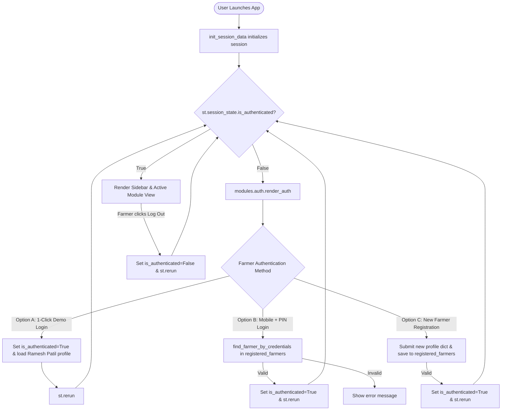
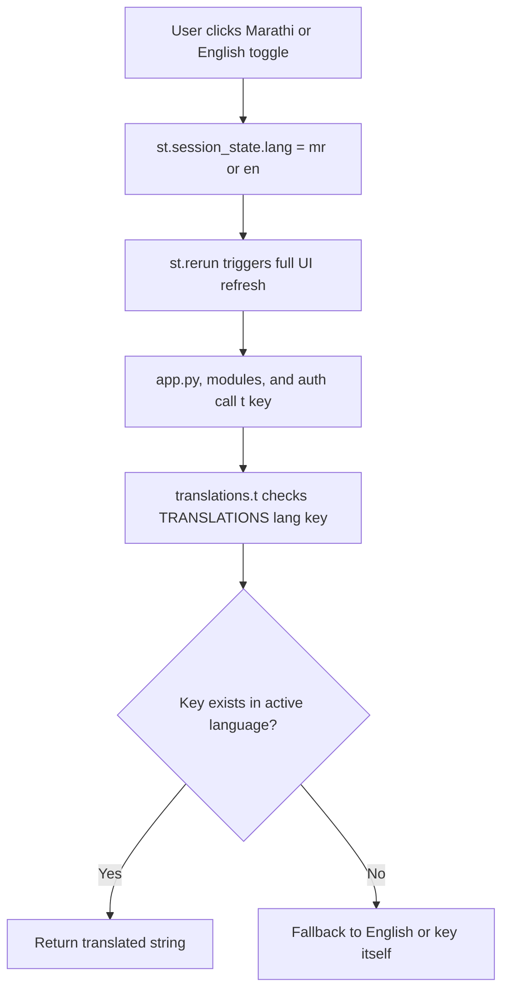

# KrishiVaani (Voice of Agriculture) — Architecture Documentation

KrishiVaani is a unified, pure-Python digital platform designed for Indian farmers, specifically tailored to the agro-climatic context of Maharashtra (starting with the Niphad/Nashik belt).

This document serves as the project's living architectural manual, written in plain English for developers and Smart India Hackathon (SIH) evaluators.

---

## 1. System Overview & Technical Guidelines

| Dimension | Specification | Rationale |
| :--- | :--- | :--- |
| **Framework** | Streamlit (Pure Python) | Fast, responsive web UI with state preservation, zero JavaScript/CSS compilation overhead, and high readability for educational presentation. |
| **Database** | **Zero External Database** | Strict project constraint. Runtime state is maintained via `st.session_state` and initialized from realistic Maharashtra sample datasets. |
| **Persistence** | In-Memory Session State | Prevents setup barriers (no MySQL/PostgreSQL/Firebase configuration needed). The app boots with rich data out-of-the-box on any computer. |
| **Architecture** | Modular Controller Pattern | `app.py` acts as a central router; distinct domain modules live in the `modules/` package. |
| **Authentication** | Session-Based Gatekeeper | `modules/auth.py` gates the dashboard until authenticated. Supports 1-Click Demo login, phone + PIN credentials, and in-memory registration. |
| **Language Support** | Separate English & Marathi Modes | Managed via `translations.py` dictionary lookups; user toggles language at login or in sidebar with instant whole-app re-rendering. |

---

## 2. Directory Structure

```text
KrishiVaani/
│
├── app.py                  # Main controller, authentication gate & navigation controller
├── sample_data.py          # Pre-loaded Maharashtra farming datasets, accounts & session initializer
├── translations.py         # Bilingual dictionary (English & Marathi) and UI switcher toggle
├── ARCHITECTURE.md         # Plain-English technical documentation & SIH judge defense manual
├── INSTRUCTIONS.md         # Hackathon project constraints & development rules
├── .gitignore              # Ignores __pycache__ and bytecode
│
└── modules/                # Modular domain implementations
    ├── __init__.py         # Python package marker
    ├── auth.py             # Login, 1-Click Demo Login & New Farmer Registration
    ├── dashboard.py        # Module 1: Farmer Profile & Dashboard Hub (Active)
    ├── crop_helper.py      # Module 2: Crop & Farming Helper (Active)
    └── nearby_services.py  # Module 4: Nearby Agricultural Services (Active)
```

---

## 3. Step 1: Module 1 — Farmer Profile & Dashboard Hub

### A. Files Created / Modified
1. `sample_data.py`:
   - Contains pre-loaded data for sample farmer **Ramesh Tukaram Patil** (4.5 acres in Pimpalgaon Baswant, Nashik, growing Grapes, Onions, and Soybeans, with Gir cows and Murrah buffaloes).
   - Contains realistic datasets ready for subsequent modules: `SAMPLE_LIVESTOCK`, `SAMPLE_SERVICES`, `SAMPLE_MARKETPLACE`, and `SAMPLE_EXPENSES`.
   - Provides `init_session_data(st)` to ensure state loads cleanly on startup without overwriting active edits.
   - Provides `reset_to_defaults(st)` to allow the farmer to restore sample values.

2. `modules/dashboard.py`:
   - `render_dashboard()`: Main view rendering the farmer greeting, farm summary metrics, profile manager, and module navigation cards.
   - `calculate_quick_stats()`: Computes dynamic statistics on-the-fly directly from memory.
   - `render_profile_view()`: Displays a summary of farmer credentials, land holding, soil type, irrigation setup, crops, and dairy production.
   - `render_profile_edit()`: Provides an interactive Streamlit form allowing farmers to modify profile fields in-place.
   - `render_module_placeholders()`: Interactive 3x2 card grid providing shortcuts to Modules 2 through 7.

3. `app.py`:
   - Sets global page metadata (title, wide layout, agricultural favicon).
   - Initializes session state on startup.
   - Renders a clean sidebar featuring farmer identity snapshot and radio navigation.

### B. Step-by-Step Data Flow
1. **App Boot:** When the farmer opens the app, `app.py` runs and calls `init_session_data(st)`.
2. **Dashboard Render:** If authenticated and `active_nav == "dashboard"`, `render_dashboard()` calculates current monthly expenditure and livestock numbers from memory and shows dynamic metric cards.
3. **Profile Toggle & Edit:** When the user clicks Edit Profile, the form opens with current values. Submitting updates `st.session_state.farmer_profile` and calls `st.rerun()`.

---

## 4. Step 2: Module 2 — Crop & Farming Helper (`modules/crop_helper.py`)

### A. Files Created / Modified
1. `modules/crop_helper.py`:
   - `detect_crop_key()`: Maps varied crop profile strings to standardized knowledge base keys.
   - `render_crop_stages()`: Generates structured tabs for the 4 core stages: Sowing/Planting, Vegetative Growth, Flowering/Fruiting, and Harvesting.
   - `render_task_checklist()`: Interactive checklist allowing farmers to filter tasks by current crop vs all crops, toggle completion status, view priority badges, and add new custom farm tasks.
   - `render_crop_helper()`: Main view controller rendering the top agricultural banner, crop metadata card, stages, and checklist.

2. `sample_data.py`:
   - Added `CROP_GUIDES` comprehensive knowledge base covering Grapes, Onion, Soybean, and Sugarcane across all 4 stages.
   - Added `SAMPLE_CROP_TASKS` with pre-populated tasks, priority tags, due periods, and boolean statuses.

### B. Step-by-Step Data Flow
1. **Crop Synchronization:** Reads `farmer_profile["crops_grown"]` from `st.session_state` and surfaces the farmer's crops in the selector.
2. **Knowledge Retrieval:** Retrieves stage-specific fertilizers, irrigation timing, pest control remedies, and expert tips from `CROP_GUIDES`.
3. **Interactive Checklist:** Toggling a checkbox immediately flips the task's status boolean in `st.session_state.crop_tasks` and recalculates the progress meter. Adding a new task appends directly to the session list.

---

## 5. Step 2: Module 4 — Nearby Agricultural Services (`modules/nearby_services.py`)

### A. Files Created / Modified
1. `modules/nearby_services.py`:
   - `render_service_card()`: Formats provider credentials, category tags, distance, operating hours, speciality list, rating, and direct `tel:` call and WhatsApp inquiry buttons.
   - `render_add_service_form()`: Form enabling farmers or local dealers to register verified service providers directly into `st.session_state.nearby_services`.
   - `render_nearby_services()`: Main controller handling 3-tier filtering (Category, Taluka, Keyword) and responsive grid layout.

2. `sample_data.py`:
   - Enhanced `SAMPLE_SERVICES` with explicit `taluka`, `district`, `verified` flags, and expanded regional coverage across Niphad, Nashik, Dindori, Chandwad, and Sinnar.

### B. Step-by-Step Data Flow
1. **Location-Aware Defaulting:** Reads the farmer's home taluka from `farmer_profile` and defaults the taluka filter automatically (e.g. Niphad).
2. **Multi-Parameter Filtering:** Dynamically matches Category, Taluka, and keyword search across provider records in memory.
3. **Instant Direct Action:** Generates clickable `tel:` links and URL-encoded WhatsApp inquiry messages pre-filled with the farmer's identity.
4. **In-Memory Registration:** Submitting a new provider appends it to `st.session_state.nearby_services` and re-renders immediately.

---

## 6. Authentication Architecture & Session Gatekeeper (`modules/auth.py` & `app.py`)



### A. How Authentication Works Without a Database
1. **Session Gatekeeper in `app.py`:**
   - At the top of `app.py`, the application checks `if not st.session_state.get("is_authenticated", False):`. If unauthenticated, it calls `render_auth()` and immediately executes `st.stop()`. This ensures no sidebar, dashboard metrics, or farm modules are accessible prior to logging in.
2. **1-Click Demo Login for SIH Evaluators:**
   - An evaluator or judge can click **"⚡ 1-Click Demo Login (Ramesh Patil)"** to bypass typing credentials. The button handler sets `st.session_state.is_authenticated = True`, loads a deep copy of `SAMPLE_FARMER`, sets `active_nav = "dashboard"`, and calls `st.rerun()`.
3. **Phone + 4-Digit PIN Validation:**
   - Pre-loaded registered accounts are stored in `st.session_state.registered_farmers` (`9822012345` with PIN `1234`).
   - `normalize_phone()` strips formatting, spaces, and `+91` prefix so farmers can type in any format.
   - `find_farmer_by_credentials()` looks up the normalized phone and compares the 4-digit PIN in memory.
4. **New Farmer Registration:**
   - When a new farmer fills out the registration tab, their profile is saved into `st.session_state.registered_farmers[normalized_phone]`. The newly created profile is assigned to `st.session_state.farmer_profile`, `is_authenticated` is set to `True`, and the farmer enters their dashboard immediately.
5. **Logout Flow:**
   - A dedicated **"🚪 Log Out"** button in the sidebar sets `st.session_state.is_authenticated = False` and triggers `st.rerun()`, immediately returning to the login gate.

### B. SIH Judge Q&A Defense for Authentication
- *Judge Question:* "Why use a 4-digit PIN instead of SMS OTP?"
- *Engineering Defense:* In an offline hackathon evaluation venue or rural area with fluctuating telecom reception, SMS OTP gateways frequently timeout, incur SMS API billing, or require internet webhooks. A 4-digit PIN is familiar to Indian farmers (similar to ATM and UPI PINs) and allows 100% reliable, zero-latency offline demonstration.

---

## 7. Dictionary-Driven Bilingual Architecture (`translations.py`)



### A. How Pure English & Marathi Switching Works
1. **Central State Source of Truth:**
   - `st.session_state.lang` stores the active language (`"mr"` for Marathi, `"en"` for English).
   - Default is `"mr"` (Marathi) to honor the primary user base of Maharashtra farmers.
2. **Dual Synchronized Mode Switchers:**
   - A mode switcher (`render_language_switcher()`) is placed on **both the Login screen** and **the top of the sidebar**.
   - Because both switchers read from and write to `st.session_state.lang`, switching the language on the login screen or inside the app takes effect immediately across all modules.
3. **`translations.py` Dictionary Engine:**
   - `TRANSLATIONS` contains comprehensive, culturally authentic translations for both languages.
   - `t(key)` resolves the string for the active language. If a key is missing in Marathi, it gracefully falls back to English, preventing runtime exceptions.
4. **Coverage Across Modules:**
   - Login Portal: Headings, buttons, labels, and error messages.
   - Sidebar: Branding, farm snapshot labels, navigation radio items, and logout.
   - Module 1 (Dashboard): KPI metrics, greetings, profile viewer/editor, and service hub cards.
   - Module 2 (Crop Helper): Stage tabs, duration, agronomy headings, and task checklist.
   - Module 4 (Nearby Services): Category filters, search labels, provider cards, and WhatsApp inquiry text.

### B. SIH Judge Q&A Defense for Bilingual Architecture
- *Judge Question:* "Why use a static dictionary instead of an automated translation API (Google Translate API)?"
- *Engineering Defense:* Machine translation APIs often produce literal, awkward translations of rural agricultural terms (for example, translating "Drip Irrigation" to literal words rather than the colloquial *"ठिबक सिंचन"* or "Downy Mildew" to non-standard terms instead of *"डाऊनी मिल्ड्यू"*). A curated dictionary ensures 100% agronomic terminology accuracy, zero API network latency, zero monthly API cost, and offline readiness.

---

## 8. Modern Split-Screen SaaS UI Architecture & Global Polish

### A. Layout Geometry & Visual Hierarchy
To transition from a prototype look into an enterprise-grade agricultural digital product, `modules/auth.py` and `app.py` were redesigned with a modern split-screen SaaS card pattern:

```text
┌─────────────────────────────────────────────────────────────────────────────┐
│                             KrishiVaani App Canvas                          │
│  ┌───────────────────────────────────┬───────────────────────────────────┐  │
│  │   LEFT PANEL (Rich Visual Brand)  │   RIGHT PANEL (Clean White Form)  │  │
│  │                                   │                                   │  │
│  │  [🌾 KrishiVaani • Badge]        │                    [मराठी|English]│  │
│  │                                   │                                   │  │
│  │     * Clean Connected Vector *    │   Welcome back, Farmer            │  │
│  │    * SVG Agricultural Diagram *   │   Enter your mobile & 4-digit PIN │  │
│  │       (Crop, Cattle, Cost, Serv)  │                                   │  │
│  │                                   │   [ Mobile Number               ] │  │
│  │                                   │   [ 4-Digit Security PIN        ] │  │
│  │   "One unified digital platform   │                                   │  │
│  │   for everyday Maharashtra farm"  │   [ 🚀 Log In to My Farm (CTA)  ] │  │
│  │                                   │   ──────────── or ────────────    │  │
│  │   (Pills: Crop, Cattle, Exp, Serv)│   [ ⚡ 1-Click Demo Login       ] │  │
│  │                                   │                                   │  │
│  │                                   │   👉 Don't have an account? Reg   │  │
│  └───────────────────────────────────┴───────────────────────────────────┘  │
└─────────────────────────────────────────────────────────────────────────────┘
```

1. **Split-Screen Ratio (`st.columns([1.15, 1], gap="large")`):**
   - **Left Panel (Brand Showcase):** Styled with a full-height deep forest gradient (`#14532D` to `#166534`), generous inner padding (38px), rounded corners (20px), and an ambient drop shadow.
   - **Right Panel (Minimalist Clean White Form):** White card (`#FFFFFF`) with 16px border-radius, soft elevation (`box-shadow: 0 4px 20px -2px rgba(0, 0, 0, 0.05)`), and top-right language switcher pill.
2. **Custom Vector SVG Farm Ecosystem:**
   - Designed in pure vector SVG (`generate_showcase_svg()`) without external raster image files or third-party graphic dependencies.
   - Features a glowing central KrishiVaani hub connected via dashed signal lines to 4 distinct domain satellites: *Crop Advisory*, *Livestock Care*, *Expense Analytics*, and *Local Services*.
   - Dynamically renders node labels in Marathi or English matching `st.session_state.lang`.
3. **Global Chrome Elimination & Typography:**
   - Injects custom CSS hiding Streamlit's default header, colored decoration ribbon, hamburger menu, and footer (`#MainMenu`, `header`, `footer`, `stToolbar`, `stDecoration`).
   - Imports Google Fonts (`Inter` for Latin characters, `Noto Sans Devanagari` for Marathi) ensuring razor-sharp rendering on all screens.
   - Standardizes inputs with `border-radius: 10px`, `#15803D` soft focus glow, and emerald green CTA buttons (`#15803D`).

### B. SIH Judge Q&A Defense for UI/UX Redesign
- *Judge Question:* "Why invest in a modern SaaS split-screen design for rural agricultural software?"
- *Engineering Defense:* User adoption among modern farmers, farmer-producer organizations (FPOs), and agri-extension workers demands high visual trust. A cluttered, amateurish prototype suggests unreliability. Clean typography, bilingual clarity, and an uncluttered visual hierarchy reduce cognitive load, making the application immediately intuitive even for first-time smartphone users.

### C. High-End SaaS Card & Animated Agricultural Landscape
- **Zero Nested Boxes & Single-Viewport Fit:** Removed all `border=True` arguments from `st.container()` and `st.form()` to eliminate nested gray boxes. Styled `div[data-testid="stHorizontalBlock"]` as a unified white card container (`background: #FFFFFF; border-radius: 24px; box-shadow: 0 20px 50px rgba(15, 23, 42, 0.08); padding: 16px; max-width: 1040px; margin: 0 auto;`), flattening default Streamlit form borders so the entire view fits neatly on a single screen without vertical scrolling.
- **Rich Animated Sunrise & Swaying Crops (`generate_animated_landscape_svg()`):** Designed a lush SVG landscape featuring a sunrise gradient (`#FEF3C7` to `#DCFCE7`), a pulsing golden sun (`@keyframes pulseGlow`), multi-layered rolling emerald terraces with contour furrows, and foreground golden wheat stalks and green leafy plants gently swaying in the breeze via pure CSS `@keyframes swayLeft` / `swayRight`.
- **Frosted Glassmorphic Overlay:** Positioned a frosted glass card (`backdrop-filter: blur(12px); background: rgba(20, 83, 45, 0.85);`) at the bottom of the landscape containing a brand badge, headline (*"Empowering Every Harvest"* / *"प्रत्येक हंगामाचे सक्षमीकरण"*), and subtitle.
- **Zero-Indentation DOM Engine:** All HTML, CSS, and SVG templates are strictly left-aligned to column 0 and parsed via `textwrap.dedent(...)`, completely eliminating Markdown 4-space code-block misinterpretation traps.

---

## 9. Summary of Edge Cases Handled

1. **Authentication Gate Bypassing:** Guarded with `st.stop()` to guarantee that unauthenticated sessions cannot execute background module logic.
2. **Phone Number Format Variations:** Normalizes `+91`, leading zeros, dashes, and whitespace before credentials lookup.
3. **Bilingual Fallbacks:** Missing keys in `TRANSLATIONS["mr"]` fall back seamlessly to English without breaking page execution.
4. **Persistent Language Across Navigation:** Switching modules preserves the selected language mode because `st.session_state.lang` is independent of `active_nav`.
5. **State Reset Isolation:** Restoring sample defaults resets farm records while maintaining the farmer's active session and language preference.
6. **Responsive Layout Collapse:** The 2-column split-screen layout gracefully stacks vertically on narrow mobile viewport widths without text truncation.
