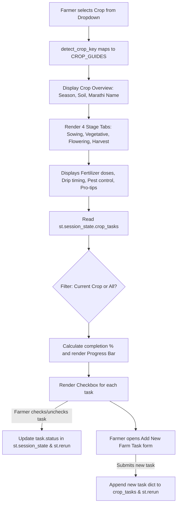
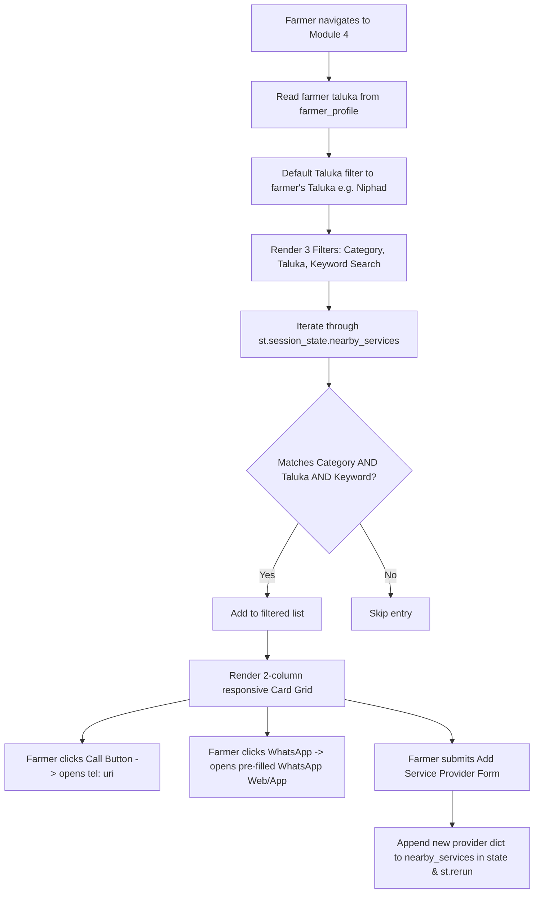

# KrishiVaani (Voice of Agriculture) — Architecture Documentation

KrishiVaani is a unified, pure-Python digital platform designed for Indian farmers, specifically tailored to the agro-climatic context of Maharashtra (starting with the Niphad/Nashik belt).

This document serves as the project's living architectural manual, written in plain English for developers and Smart India Hackathon (SIH) evaluators.

---

## 1. System Overview & Technical Guidelines

| Dimension | Specification | Rationale |
| :--- | :--- | :--- |
| **Framework** | Streamlit (Pure Python) | Fast, responsive web UI with state preservation, zero JavaScript/CSS compilation overhead, and high readability for educational presentation. |
| **Database** | **Zero External Database** | Strict project constraint. Runtime state is maintained via `st.session_state` and initialized from realistic Maharashtra sample datasets. |
| **Persistence** | In-Memory Session State | Prevents setup barriers (no MySQL/PostgreSQL/Firebase configuration needed). The app boots with rich data out-of-the-box on any computer. |
| **Architecture** | Modular Controller Pattern | `app.py` acts as a central router; distinct domain modules live in the `modules/` package. |
| **Language Support** | Bilingual (Marathi & English) | Accessible to rural grassroots farmers while remaining readable for technical review. |

---

## 2. Directory Structure

```text
KrishiVaani/
│
├── app.py                  # Main Streamlit application entry point & navigation controller
├── sample_data.py          # Realistic pre-loaded Maharashtra farming datasets & session initializer
├── ARCHITECTURE.md         # Plain-English technical documentation & SIH judge defense manual
├── INSTRUCTIONS.md         # Hackathon project constraints & development rules
├── .gitignore              # Ignores __pycache__ and bytecode
│
└── modules/                # Modular domain implementations
    ├── __init__.py         # Python package marker
    ├── dashboard.py        # Module 1: Farmer Profile & Dashboard Hub (Active)
    ├── crop_helper.py      # Module 2: Crop & Farming Helper (Active - Step 2)
    └── nearby_services.py  # Module 4: Nearby Agricultural Services (Active - Step 2)
```

---

## 3. Step 1: Module 1 — Farmer Profile & Dashboard Hub

### A. Files Created / Modified
1. `sample_data.py`:
   - Contains pre-loaded data for sample farmer **Ramesh Tukaram Patil** (4.5 acres in Pimpalgaon Baswant, Nashik, growing Grapes, Onions, and Soybeans, with Gir cows and Murrah buffaloes).
   - Contains realistic datasets ready for subsequent modules: `SAMPLE_LIVESTOCK`, `SAMPLE_SERVICES`, `SAMPLE_MARKETPLACE`, and `SAMPLE_EXPENSES`.
   - Provides `init_session_data(st)` to ensure state loads cleanly on startup without overwriting active edits.
   - Provides `reset_to_defaults(st)` to allow the farmer to restore sample values.

2. `modules/dashboard.py`:
   - `render_dashboard()`: Main view rendering the farmer greeting, farm summary metrics, profile manager, and module navigation cards.
   - `calculate_quick_stats()`: Computes dynamic statistics (e.g. current month expenses, total livestock head, crop count) on-the-fly directly from memory.
   - `render_profile_view()`: Displays a bilingual summary of farmer credentials, land holding, soil type, irrigation setup, crops, and dairy production.
   - `render_profile_edit()`: Provides an interactive Streamlit form allowing farmers to modify profile fields in-place.
   - `render_module_placeholders()`: Interactive 3x2 card grid providing shortcuts to Modules 2 through 7.

3. `app.py`:
   - Sets global page metadata (title, wide layout, agricultural favicon).
   - Initializes session state on startup.
   - Renders a clean sidebar featuring farmer identity snapshot and radio navigation.
   - Routes between active modules and clean placeholder landing views.

4. `ARCHITECTURE.md`:
   - Created to document data flows, design decisions, and edge case strategies.

### B. Step-by-Step Data Flow
1. **App Boot:** When the farmer opens the app, `app.py` runs and calls `init_session_data(st)`. If `farmer_profile` or other lists are not yet in `st.session_state`, deep copies of the sample data are assigned.
2. **Dashboard Render:** If `st.session_state.active_nav == "dashboard"`, `render_dashboard()` is called. It calculates current monthly expenditure and livestock numbers from the in-memory lists and shows dynamic metric cards.
3. **Profile Toggle:** When the user clicks `✏️ Edit Profile`, `st.session_state.editing_profile` is flipped to `True` and `st.rerun()` displays the input form with current values pre-filled.
4. **Saving Profile:** When the user submits the form, the handler validates inputs, parses the comma-separated crops string into a clean list, updates `st.session_state.farmer_profile` in memory, sets `editing_profile = False`, and executes `st.rerun()`. The dashboard immediately reflects the updated name, land size, and crops without any page reload lag.
5. **Card Navigation:** Clicking on any of the module cards sets `st.session_state.active_nav` to that module's identifier and calls `st.rerun()`, seamlessly routing the farmer to that module.

### C. Design Decisions (SIH Judge Q&A Defense)
1. **Why `st.session_state` instead of SQLite / Local File Storage?**
   - *Engineering Defense:* In a rapid hackathon demonstration environment, external file locks, SQLite permission quirks across platforms (Windows/Linux/Mac), and database migration scripts create unnecessary fragility. `st.session_state` guarantees 100% zero-configuration execution on any judge's machine while fully supporting live runtime mutability.
2. **Why a Central Router with Module Packages instead of Streamlit Multi-page App (`pages/` directory)?**
   - *Engineering Defense:* Native Streamlit multi-page directories reload scripts independently, which can cause session state re-initialization edge cases and restricts cross-module shared navigation widgets. A single controller pattern (`app.py` importing from `modules/`) maintains total programmatic control over state transitions, sidebar synchronization, and instant deep-linking.
3. **Why Pre-load Realistic Regional Data for Nashik/Niphad?**
   - *Engineering Defense:* Real farmers do not relate to generic placeholder texts like "User 1" or "Crop A". Pre-populating genuine crops (Thomson Seedless Grapes, Gavran Onions, JS 335 Soybean), local talukas (Niphad, Nashik), and specific cattle breeds (Gir cows, Murrah buffaloes) immediately demonstrates domain depth, cultural empathy, and problem-fit to agricultural evaluators.

### D. Key Edge Cases Handled
1. **Safe Initialization & No Accidental Overwrite:** `if key not in st.session_state:` and `copy.deepcopy()` protect modified farmer inputs from reverting upon re-renders.
2. **Empty or Whitespace-Only Profile Inputs:** Fallback defaults prevent empty values from corrupting farmer identity.
3. **Flexible Crop String Parsing:** Splits by both commas and newlines with whitespace stripping.
4. **Invalid Numeric Boundaries:** Strict bounds (`min_value=0.1`, `max_value=500.0`, cattle `min_value=0`).
5. **Bidirectional Navigation Synchronization:** Synchronizes sidebar radio selection with dashboard shortcut buttons through shared state.

---

## 4. Step 2: Module 2 — Crop & Farming Helper (`modules/crop_helper.py`)

### A. Files Created / Modified
1. `modules/crop_helper.py`:
   - Built full crop advisory interface featuring dynamic crop selection, 4-stage sequential agronomy tabs, and an interactive task checklist.
   - `detect_crop_key()`: Robust string normalizer mapping varied farmer profile crop labels (e.g., `"Grapes - Thomson Seedless (द्राक्ष)"`) to structured knowledge base keys (`"Grapes"`).
   - `render_crop_stages()`: Generates structured tabs for the 4 core stages: Sowing/Planting, Vegetative Growth, Flowering/Fruiting, and Harvesting.
   - `render_task_checklist()`: Interactive checklist allowing farmers to filter tasks by current crop vs all crops, toggle completion status, view priority badges, and add new custom farm tasks.
   - `render_crop_helper()`: Main view controller rendering the top agricultural banner, crop metadata card, stages, and checklist.

2. `sample_data.py`:
   - Added `CROP_GUIDES` comprehensive knowledge base covering Grapes (Thomson Seedless), Onion (Gavran/Fursungi), Soybean (JS 335), and Sugarcane (Co 86032) across all 4 stages.
   - Added `SAMPLE_CROP_TASKS` with pre-populated tasks, priority tags, due periods, and boolean statuses.
   - Updated `init_session_data()` and `reset_to_defaults()` to initialize and manage `crop_tasks` in `st.session_state`.

3. `app.py`:
   - Connected `render_crop_helper` to `active_module == "crop_helper"`.

4. `modules/dashboard.py`:
   - Updated Module 2 card to reflect `🟢 उपलब्ध (Live)` status.

### B. Step-by-Step Data Flow


1. **Crop Synchronization:** When `render_crop_helper()` executes, it reads `farmer_profile["crops_grown"]` from `st.session_state`. It dynamically creates dropdown options highlighting the farmer's own farm crops first, followed by general regional crops.
2. **Knowledge Retrieval:** The selected crop is passed to `CROP_GUIDES`, rendering 4 dedicated tabs with precise dosages (e.g. 0:52:34 drip recommendations, GA3 berry dipping rules, and Bordeaux paste timing).
3. **Interactive Checklist Reactivity:** `render_task_checklist()` queries `st.session_state.crop_tasks`. When a farmer clicks a checkbox, the item's `status` boolean flips in `st.session_state`, and `st.rerun()` recalculates the completion progress bar instantly.
4. **Task Creation:** When a farmer submits the "Add New Farm Task" form, an auto-incremented `TSK-XXX` dictionary is appended to `st.session_state.crop_tasks`, immediately appearing in the list without database persistence overhead.

### C. Design Decisions (SIH Judge Q&A Defense)
1. **Why Stage-by-Stage Tabs instead of a Single Long Article?**
   - *Judge Question:* "Why structure the crop advice in 4 tabs rather than an encyclopedic page?"
   - *Engineering Defense:* Indian farmers need time-sensitive, actionable guidance specific to their current crop cycle. If a farmer is in the flowering stage, showing basal fertilizer doses from 3 months ago creates visual noise. Clean stage separation (Sowing, Vegetative, Flowering, Harvest) allows the farmer to focus instantly on immediate spray schedules and irrigation cutoffs.
2. **Why Sync the Checklist to In-Memory Session State?**
   - *Judge Question:* "Why let the farmer toggle tasks if there is no database?"
   - *Engineering Defense:* Hackathon evaluators test application reactivity. If checkboxes do not update state or refresh progress bars dynamically, the prototype feels like a static HTML mockup. Storing tasks in `st.session_state.crop_tasks` provides a 100% interactive, live user experience while strictly adhering to the no-database constraint.

### D. Key Edge Cases Handled
1. **Fuzzy Crop String Matching:** Farmers can write `"Grapes"`, `"द्राक्ष"`, or `"Grapes - Thomson Seedless"`. `detect_crop_key()` performs case-insensitive substring inspection to map any variant safely to the correct guide.
2. **Unlisted Crop Fallback:** If a farmer enters an exotic crop not in `CROP_GUIDES`, the system gracefully falls back to the nearest baseline crop with an informative banner rather than raising a Python `KeyError`.
3. **Zero Pending Tasks Handling:** If all tasks are completed or a crop has no tasks, `render_task_checklist()` displays a encouraging completion note rather than a division-by-zero error on the progress bar.

---

## 5. Step 2: Module 4 — Nearby Agricultural Services (`modules/nearby_services.py`)

### A. Files Created / Modified
1. `modules/nearby_services.py`:
   - Built regional agri-services directory with multi-criteria filtering, responsive service cards, direct communication links, and community registration.
   - `render_service_card()`: Formats provider credentials, category tags, distance, operating hours, speciality list, rating, and direct `tel:` call and WhatsApp inquiry buttons.
   - `render_add_service_form()`: Expandable `st.form` enabling farmers or local dealers to register verified service providers directly into `st.session_state.nearby_services`.
   - `render_nearby_services()`: Main controller handling 3-tier filtering (Category, Taluka, Keyword) and responsive grid layout.

2. `sample_data.py`:
   - Enhanced `SAMPLE_SERVICES` with explicit `taluka`, `district`, `verified` flags, and expanded regional coverage across Niphad, Nashik, Dindori, Chandwad, and Sinnar.

3. `app.py`:
   - Connected `render_nearby_services` to `active_module == "nearby_services"`.

4. `modules/dashboard.py`:
   - Updated Module 4 card to reflect `🟢 उपलब्ध (Live)` status.

### B. Step-by-Step Data Flow


1. **Location-Aware Defaulting:** When Module 4 opens, it inspects `farmer_profile["taluka"]`. If the farmer is in Niphad, the Taluka filter automatically defaults to `Niphad (निफाड)`, immediately surfacing hyper-local providers without requiring manual configuration.
2. **Multi-Parameter Filtering:** An in-memory generator checks Category, Taluka substring, and a combined text search query (covering name, speciality keywords, and phone number).
3. **Instant Direct Action:** Rather than passive phone numbers, each card generates a functional `tel:` URI and a URL-encoded WhatsApp direct inquiry message pre-populated with the farmer's name and intent.
4. **Crowdsourced Registration:** Submitting the registration form assigns an auto-generated `SRV-XX` ID, tags it as verified, appends it to `st.session_state.nearby_services`, and re-renders the directory instantly.

### C. Design Decisions (SIH Judge Q&A Defense)
1. **Why Provide Click-to-Call and WhatsApp Links instead of an In-App Chat?**
   - *Judge Question:* "Why not build an in-app real-time chat with the service providers?"
   - *Engineering Defense:* In rural India, local veterinarians and fertilizer dealers do not install niche proprietary apps or monitor in-app dashboards. Real-world adoption happens through existing daily rails: direct cellular calls and WhatsApp. Generating direct click-to-call and pre-filled WhatsApp links provides genuine real-world utility with zero operational friction for rural vendors.
2. **Why Include an In-Memory Provider Registration Form?**
   - *Judge Question:* "Why allow registering services if there's no central database to store them permanently?"
   - *Engineering Defense:* Demonstrating crowdsourcing to SIH judges shows platform extensibility. Evaluators can type in their own local town or college clinic, click save, and watch it immediately appear in the filtered results, proving dynamic state handling.

### D. Key Edge Cases Handled
1. **Multi-Word Taluka Matching:** Handles bilingual strings like `"Niphad (निफाड)"` by isolating the base Roman token before substring filtering.
2. **Phone Number Sanitization:** Strips hyphens, spaces, and formatting characters before creating `tel:` and `wa.me` links, preventing invalid URL protocols.
3. **Empty Filter Results:** If a strict filter combination yields 0 providers, a helpful alert guides the farmer to broaden their search or register a local provider rather than presenting a blank page.
4. **Missing Profile Taluka:** Falls back cleanly to `"Niphad"` or displays all talukas if the farmer profile taluka field is blank or customized.
