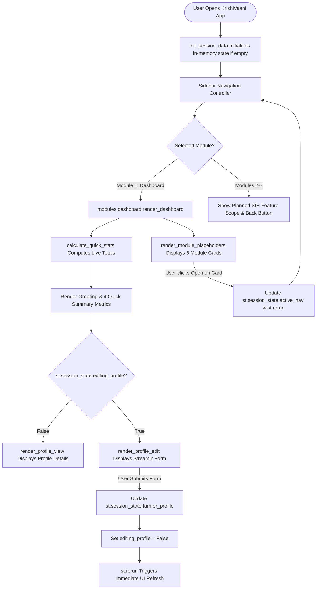

# KrishiVaani (Voice of Agriculture) — Architecture Documentation

KrishiVaani is a unified, pure-Python digital platform designed for Indian farmers, specifically tailored to the agro-climatic context of Maharashtra (starting with the Niphad/Nashik belt).

This document serves as the project's living architectural manual, written in plain English for developers and Smart India Hackathon (SIH) evaluators.

---

## 1. System Overview & Technical Guidelines

| Dimension | Specification | Rationale |
| :--- | :--- | :--- |
| **Framework** | Streamlit (Pure Python) | Fast, responsive web UI with state preservation, zero JavaScript/CSS compilation overhead, and high readability for educational presentation. |
| **Database** | **Zero External Database** | Strict project constraint. Runtime state is maintained via `st.session_state` and initialized from realistic Maharashtra sample datasets. |
| **Persistence** | In-Memory Session State | Prevents setup barriers (no MySQL/PostgreSQL/Firebase configuration needed). The app boots with rich data out-of-the-box on any computer. |
| **Architecture** | Modular Controller Pattern | `app.py` acts as a central router; distinct domain modules live in the `modules/` package. |
| **Language Support** | Bilingual (Marathi & English) | Accessible to rural grassroots farmers while remaining readable for technical review. |

---

## 2. Directory Structure

```text
KrishiVaani/
│
├── app.py                  # Main Streamlit application entry point & navigation controller
├── sample_data.py          # Realistic pre-loaded Maharashtra farming datasets & session initializer
├── ARCHITECTURE.md         # Plain-English technical documentation & SIH judge defense manual
├── INSTRUCTIONS.md         # Hackathon project constraints & development rules
│
└── modules/                # Modular domain implementations
    ├── __init__.py         # Python package marker
    └── dashboard.py        # Module 1: Farmer Profile & Dashboard Hub
```

---

## 3. Step 1: Module 1 — Farmer Profile & Dashboard Hub

### A. Files Created / Modified
1. `sample_data.py`:
   - Contains pre-loaded data for sample farmer **Ramesh Tukaram Patil** (4.5 acres in Pimpalgaon Baswant, Nashik, growing Grapes, Onions, and Soybeans, with Gir cows and Murrah buffaloes).
   - Contains realistic datasets ready for subsequent modules: `SAMPLE_LIVESTOCK`, `SAMPLE_SERVICES`, `SAMPLE_MARKETPLACE`, and `SAMPLE_EXPENSES`.
   - Provides `init_session_data(st)` to ensure state loads cleanly on startup without overwriting active edits.
   - Provides `reset_to_defaults(st)` to allow the farmer to restore sample values.

2. `modules/dashboard.py`:
   - `render_dashboard()`: Main view rendering the farmer greeting, farm summary metrics, profile manager, and module navigation cards.
   - `calculate_quick_stats()`: Computes dynamic statistics (e.g. current month expenses, total livestock head, crop count) on-the-fly directly from memory.
   - `render_profile_view()`: Displays a bilingual summary of farmer credentials, land holding, soil type, irrigation setup, crops, and dairy production.
   - `render_profile_edit()`: Provides an interactive Streamlit form allowing farmers to modify profile fields in-place.
   - `render_module_placeholders()`: Interactive 3x2 card grid providing shortcuts to Modules 2 through 7.

3. `app.py`:
   - Sets global page metadata (title, wide layout, agricultural favicon).
   - Initializes session state on startup.
   - Renders a clean sidebar featuring farmer identity snapshot and radio navigation.
   - Routes between `Module 1: Dashboard` and clean placeholder landing views for `Modules 2–7`.

4. `ARCHITECTURE.md`:
   - Created to document data flows, design decisions, and edge case strategies.

---

### B. Step-by-Step Data Flow



1. **App Boot:** When the farmer opens the app, `app.py` runs and calls `init_session_data(st)`. If `farmer_profile` or other lists are not yet in `st.session_state`, deep copies of the sample data are assigned.
2. **Dashboard Render:** If `st.session_state.active_nav == "dashboard"`, `render_dashboard()` is called. It calculates current monthly expenditure and livestock numbers from the in-memory lists and shows dynamic metric cards.
3. **Profile Toggle:** When the user clicks `✏️ Edit Profile`, `st.session_state.editing_profile` is flipped to `True` and `st.rerun()` displays the input form with current values pre-filled.
4. **Saving Profile:** When the user submits the form, the handler validates inputs, parses the comma-separated crops string into a clean list, updates `st.session_state.farmer_profile` in memory, sets `editing_profile = False`, and executes `st.rerun()`. The dashboard immediately reflects the updated name, land size, and crops without any page reload lag.
5. **Card Navigation:** Clicking on any of the 6 module cards sets `st.session_state.active_nav` to that module's identifier and calls `st.rerun()`, seamlessly routing the farmer to that module.

---

### C. Design Decisions (SIH Judge Q&A Defense)

1. **Why `st.session_state` instead of SQLite / Local File Storage?**
   - *Judge Question:* "Why don't you have a SQLite database or JSON file for storage?"
   - *Engineering Defense:* In a rapid hackathon demonstration environment, external file locks, SQLite permission quirks across platforms (Windows/Linux/Mac), and database migration scripts create unnecessary fragility. `st.session_state` guarantees 100% zero-configuration execution on any judge's machine while fully supporting live runtime mutability (editing profile, adding expenses, updating vaccinations).

2. **Why a Central Router with Module Packages instead of Streamlit Multi-page App (`pages/` directory)?**
   - *Judge Question:* "Why not use Streamlit's default `pages/` directory?"
   - *Engineering Defense:* Native Streamlit multi-page directories reload scripts independently, which can cause session state re-initialization edge cases and restricts cross-module shared navigation widgets. A single controller pattern (`app.py` importing from `modules/`) maintains total programmatic control over state transitions, sidebar synchronization, and instant deep-linking from dashboard summary cards.

3. **Why Pre-load Realistic Regional Data for Nashik/Niphad?**
   - *Judge Question:* "Why are the names and locations specific to Maharashtra?"
   - *Engineering Defense:* Real farmers do not relate to generic placeholder texts like "User 1" or "Crop A". Pre-populating genuine crops (Thomson Seedless Grapes, Gavran Onions, JS 335 Soybean), local talukas (Niphad, Nashik), and specific cattle breeds (Gir cows, Murrah buffaloes) immediately demonstrates domain depth, cultural empathy, and problem-fit to agricultural domain evaluators.

---

### D. Key Edge Cases Handled

1. **Safe Initialization & No Accidental Overwrite:**
   - Using `if key not in st.session_state:` and `copy.deepcopy()` ensures that re-running `app.py` on every button click never resets modified farmer inputs back to defaults.
2. **Empty or Whitespace-Only Profile Inputs:**
   - Fallback logic (`name_input.strip() or profile.get("name")`) prevents accidental profile corruption if a farmer clears the name input and hits submit.
3. **Flexible Crop String Parsing:**
   - The crop input supports both newline-delimited and comma-separated inputs with automatic stripping of trailing whitespace and empty strings (`[c.strip() for c in ... if c.strip()]`).
4. **Invalid Numeric Boundaries:**
   - Land size has explicit bounds (`min_value=0.1`, `max_value=500.0`), preventing negative numbers or zero-acre profiles.
   - Cattle counters are non-negative integers (`min_value=0`).
5. **Bidirectional Navigation Synchronization:**
   - If a farmer clicks "Open Module 2" on the dashboard card, the sidebar radio selection updates synchronously because both read from and write to the same single source of truth (`st.session_state.active_nav`).
6. **One-Click State Reset:**
   - If a judge or farmer experiments with edits and wants to return to the baseline demonstration state, the "Reset to Default Sample Data" button cleanly restores initial values.
